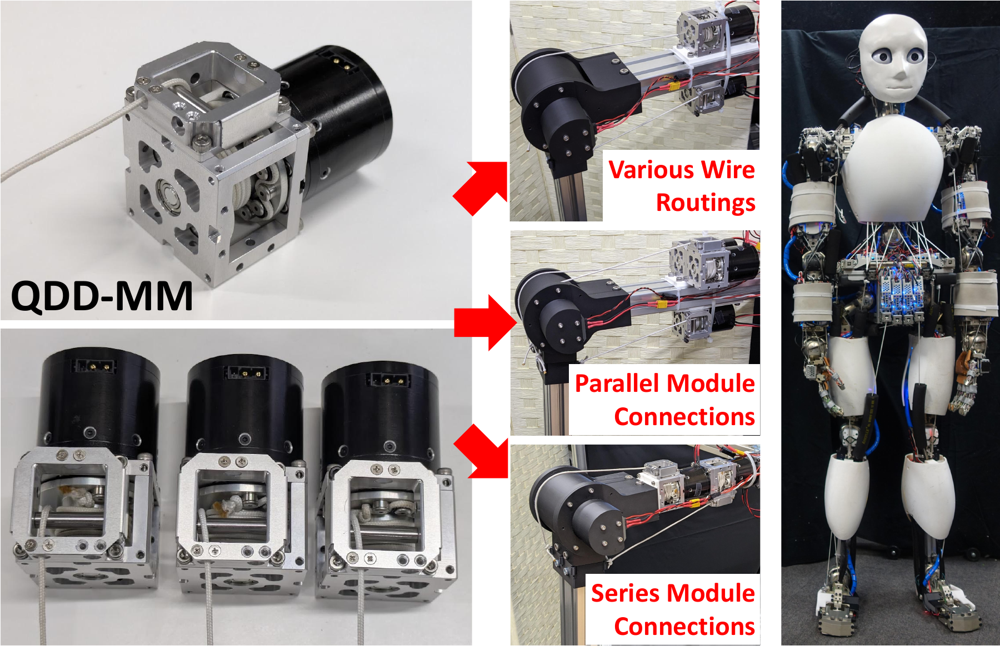

# QDD-MM: Quasi-Direct-Drive Muscle Module

A simple and compact open-source muscle module for tendon-driven robots, combining a quasi-direct-drive motor with configurable wire routing and parallel or series module connections.

**Accepted at Humanoids 2026** — IEEE-RAS International Conference on Humanoid Robots.

[Project website](https://haraduka.github.io/qddmm/) · [Paper PDF](docs/assets/paper.pdf) · [Video](https://youtu.be/09xRhZO497k) · [Design files (Google Drive)](https://drive.google.com/drive/folders/1PGDll5MoJPhwdC_somhJeLg_bphG-0lB?usp=drive_link) · [Citation](#citation)



## Repository contents

```text
qddmm/
├── README.md
├── LICENSE
└── docs/               # Project website, published with GitHub Pages
    ├── index.html
    ├── assets/
    ├── robots.txt
    └── sitemap.xml
```

This repository provides the project documentation and website. Mechanical design files are distributed through Google Drive. Motor-control software is not included.

## Design files and assembly

Download the mechanical design package from **[Google Drive](https://drive.google.com/drive/folders/1PGDll5MoJPhwdC_somhJeLg_bphG-0lB?usp=drive_link)**:

- `QDD-MM.STEP`: full module assembly.
- `STEP/`: individual component models.
- `Parts-List.xlsx`: materials, purchased components, and quantities.

Open the assembly in a STEP-compatible CAD application and review the parts list before fabrication. The main machined components use A7075 aluminum alloy, and the top cover uses A5052 sheet metal.

### Assembly videos

- **[Assembling a QDD-MM muscle module](https://haraduka.github.io/qddmm/#assembly)** (32× speed): wire attachment and assembly of the module itself. [Direct video](docs/assets/videos/whole-assembly-x32.mp4).
- **[Connecting muscle modules](https://haraduka.github.io/qddmm/#module-connection-videos)** (8× speed): two examples of joining completed modules using attachments.

See the [paper](docs/assets/paper.pdf) for wire routing and connector arrangements.

### Module specifications

| Property | Value |
| --- | --- |
| Motor | RobStride05 with integrated driver, CAN communication |
| Dimensions | 46 × 58 × 82 mm |
| Module mass | 0.34 kg |
| Gear ratio | 7.75:1 |
| Winding pulley diameter | 24 mm |
| Continuous maximum tension | 133 N |
| No-load winding speed | 603 mm/s |
| Tendon | 2 mm-diameter Zylon wire |

The tension and speed values above use the 24 mm pulley. A 12 mm pulley provides 267 N continuous maximum tension and 302 mm/s no-load winding speed.

## Project website

The static website lives in [docs/](docs/). No build step is required.

From the repository root, preview it with:

```sh
python3 -m http.server 8000 --directory docs
```

Open http://localhost:8000. Use an HTTP server when previewing the YouTube embed.

To publish from `haraduka/qddmm`, push this repository to GitHub, then select **Settings → Pages → Build and deployment → Deploy from a branch**, choosing **main** and **/docs**. The configured website URL is https://haraduka.github.io/qddmm/.

See [docs/README.md](docs/README.md) for website maintenance notes.

## Citation

```bibtex
@inproceedings{kawaharazuka2026qddmm,
  title = {QDD-MM: A Simple and Compact Open-Source Muscle Module
           with Quasi-Direct-Drive Motor for Tendon-driven Robots},
  author = {Kento Kawaharazuka and Yoshimoto Ribayashi and
            Takahiro Hattori and Shunnosuke Yoshimura and Kei Okada},
  booktitle = {Proceedings of the IEEE-RAS International Conference on Humanoid Robots},
  year = {2026},
  url = {https://github.com/haraduka/qddmm}
}
```

## Authors and contact

Kento Kawaharazuka, Yoshimoto Ribayashi, Takahiro Hattori, Shunnosuke Yoshimura, and Kei Okada. Department of Mechano-Informatics, The University of Tokyo.

For questions, contact [Kento Kawaharazuka](https://haraduka.github.io) at kawaharazuka@jsk.imi.i.u-tokyo.ac.jp.

## License

The supplied design package's [MIT License](LICENSE) is retained in this repository.
